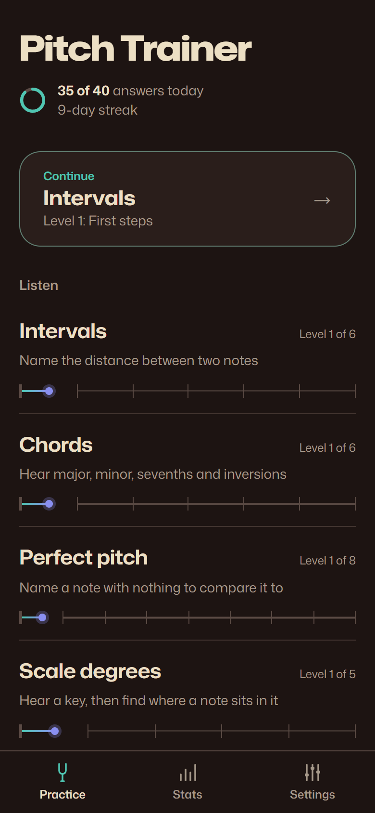
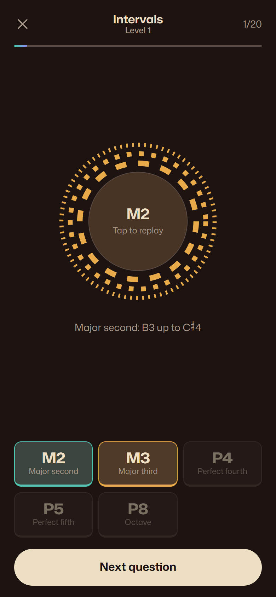
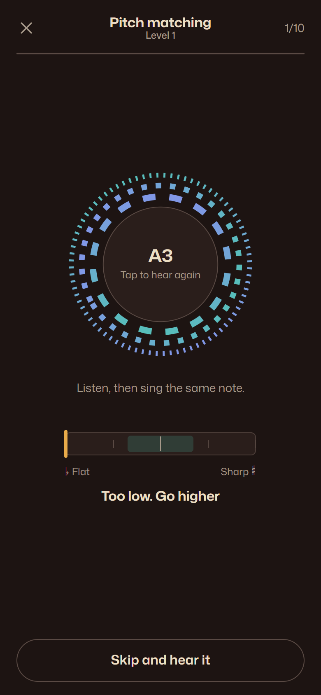
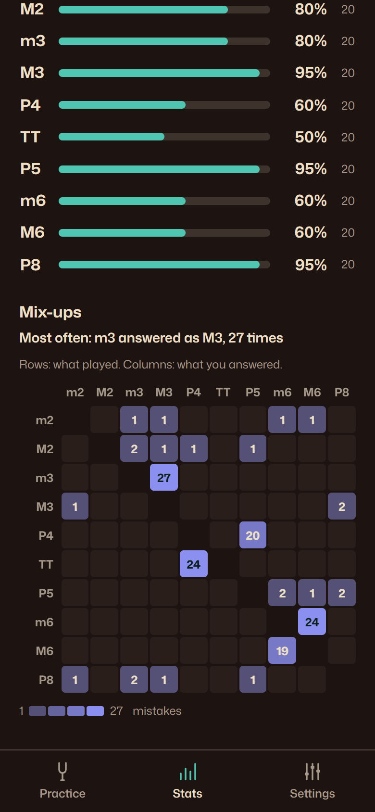

# Pitch Trainer

An ear-training app for your phone. Train intervals, chords, perfect pitch, scale degrees, scales and modes, and chord progressions, and practise singing in tune against a live tuner.

**[Open the app →](https://pitch-trainer-tau.vercel.app)**

<p align="center">
  
  
  
  
</p>

## Install it on your phone

It's a Progressive Web App, so there's no app store. Once added to your home screen it opens full screen and works offline.

- **iPhone:** open the link in Safari, tap Share, then **Add to Home Screen**.
- **Android:** open the link in Chrome and tap **Install** (or ⋮ → **Add to Home screen**).

Your progress stays on your phone. There's no account and nothing is sent anywhere.

## Exercises

| Exercise | What you do | Levels |
|---|---|---|
| **Intervals** | Name the distance between two notes, played up, down or together | 6 |
| **Chords** | Hear major, minor, diminished and augmented, then sevenths and inversions | 6 |
| **Perfect pitch** | Name a note with nothing to compare it to; starts with a few notes and adds more | 8 |
| **Scale degrees** | A cadence sets the key, then you place a note in it | 5 |
| **Scales and modes** | Tell major, the three minors, the church modes, pentatonics and blues apart | 5 |
| **Progressions** | Follow a short progression chord by chord in roman numerals | 5 |
| **Pitch matching** | Sing a note or an interval and hold it in tune on the tuner | 5 |

Each level unlocks the next once you reach 85% over 20 answers. Within a level, practice is adaptive: items you get wrong, or keep mixing up with something else, come round more often.

## Features

- **The strobe ring.** Concentric bands spin while a sound plays, and you tap the ring to hear it again. In pitch matching it becomes a strobe tuner: the bands drift one way when you're sharp and the other way when you're flat, and stand still when you're in tune.
- **Five instruments:** piano, acoustic guitar, strings, organ and flute, or a random one each question so you learn the pitch and not the timbre.
- **Stats:** a 30-day chart against your daily goal, accuracy for every answer, and a heatmap of which answers you mix up.
- **Streaks and a daily goal**, with a summary after each session.
- **Plays with the iPhone silent switch on.** Feedback sounds are deliberately unpitched so they never give you a reference note. On Android, right and wrong answers also vibrate.
- **Light and dark themes**, with dark as the default. Checked against WCAG 2.1 AA.

## Development

```sh
npm install
npm run dev        # http://localhost:5173
npm run dev:phone  # HTTPS on your local network, to test the mic and install on a real phone
npm test           # unit tests: theory, question generation, scheduling, stats
npm run build      # production build and service worker in dist/
npm run preview    # serve the build on http://localhost:4173
```

`scripts/` holds browser checks that drive the built app with Playwright and your installed Chrome. For example, `node scripts/check-session.mjs`, `check-singing.mjs` (it uses a fake microphone), `check-offline.mjs` and `a11y.mjs` (an axe-core scan). Each one takes an optional base URL.

### Stack

Vite, React, TypeScript, [Tone.js](https://tonejs.github.io/) for audio, [tonal](https://github.com/tonaljs/tonal) for music theory, [pitchy](https://github.com/ianprime0509/pitchy) for pitch detection, [Dexie](https://dexie.org/) on IndexedDB for history, zustand for settings, and vite-plugin-pwa for offline support. Deployed on Vercel.

### Layout

```
src/
  theory/      notes, intervals, chords, scales, keys          ┐ plain TypeScript,
  exercises/   one definition per exercise and its levels      │ no DOM or React,
  srs/         adaptive scheduling, unlocks, streaks, stats    ┘ reusable in a native app
  audio/       audio engine, sampled instruments, feedback sounds
  mic/         microphone and pitch tracking
  db/          IndexedDB tables and queries
  ui/          the strobe ring, practice runners, charts
  routes/      Home, Practice, Stats, Settings
```

## Credits

- Piano samples: Salamander Grand Piano by Alexander Holm, [CC BY 3.0](https://creativecommons.org/licenses/by/3.0/).
- Guitar, strings, organ and flute samples: [tonejs-instruments](https://github.com/nbrosowsky/tonejs-instruments) by Nicholaus Brosowsky, [CC BY 3.0](https://creativecommons.org/licenses/by/3.0/).
